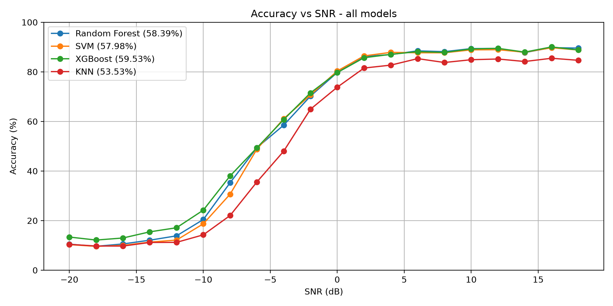

# RF Modulation Classification (RadioML 2016.10a)

Classifies radio signals into **11 modulation types** with four classical machine-learning models: **Random Forest, SVM, XGBoost and KNN**.

Course project, 23AID205 Introduction to AI & ML, Group A-8, Amrita Vishwa Vidyapeetham, Coimbatore.

## Results (test set: 44,000 signals, all 20 SNR levels)

| Metric | Random Forest | SVM | **XGBoost** | KNN |
| --- | --- | --- | --- | --- |
| Accuracy (%) | 58.41 | 57.98 | **59.68** | 53.53 |
| Precision, macro (%) | 70.93 | 71.21 | 66.49 | 63.59 |
| Recall, macro (%) | 58.41 | 57.98 | **59.68** | 53.53 |
| F1-score, macro (%) | 60.93 | 60.34 | **61.00** | 55.11 |
| Cohen's Kappa | 0.543 | 0.538 | **0.557** | 0.489 |
| MCC | 0.564 | 0.561 | **0.567** | 0.506 |
| Accuracy at SNR ≥ 0 dB (%) | 87.55 | 87.42 | 87.33 | 83.15 |



## How to run

```
pip install -r requirements.txt
python main.py            # uses the saved models
python main.py --train    # trains all models again (SVM takes about an hour)
```

The terminal shows, for each model: accuracy, precision, recall, F1-score, Cohen's Kappa, MCC, the classification report, the confusion matrix and accuracy for each SNR level, then a final comparison. Plots are saved in `results/`.

On the first run, `main.py` rebuilds the dataset and calculates the features (a few minutes); later runs start in seconds.

## Folders

```
AIML_code/
├── main.py             load data -> features -> split -> train/test -> compare
├── README.md
├── requirements.txt    library versions
├── src/
│   ├── features.py     176 features calculated from each signal
│   ├── evaluate.py     prints results and saves plots
│   └── models/         random_forest.py, svm.py, xgboost_model.py, knn.py
├── dataset/            RadioML 2016.10a (3 compressed parts, see below)
├── saved_models/       trained Random Forest, SVM and XGBoost models
└── results/            confusion matrices, accuracy-vs-SNR and comparison plots
```

## Dataset

RadioML 2016.10a (DeepSig): 220,000 I/Q signals of shape 2 × 128, 11 classes, SNR from −20 to +18 dB.

GitHub does not allow files over 100 MB, so the 641 MB `RML2016.10a_dict.pkl` is stored as 3 compressed parts in `dataset/`. `main.py` joins and unzips them automatically on the first run (MD5 of the rebuilt file: `61bf35ac7f0b7d8843613453447ea290`).

Source: [deepsig.ai/datasets](https://www.deepsig.ai/datasets) (O'Shea & West, GNU Radio Conference 2016), licensed under CC BY-NC-SA 4.0.

**Not in the repository (too large, recreated automatically):** `dataset/features.npz` (feature cache) and `saved_models/knn.joblib` (KNN is re-fitted in seconds).

## Method

1. Extract **176 features** per signal: statistics, 4th-order cumulants, power-of-signal peaks, phase moments, amplitude quantiles, autocorrelation, SNR estimate, spectrum bins and instantaneous-frequency quantiles.
2. Stratified 80/20 train/test split (random_state = 42).
3. Train Random Forest, SVM (RBF), XGBoost and KNN with tuned hyperparameters.
4. Evaluate with accuracy, macro precision/recall/F1, Cohen's Kappa, MCC, confusion matrix and accuracy per SNR.

## Team

S. Sujitkumar · M. Hemanthkumar · N. Sai Sushanth Reddy · H. Abinavkumaran

Instructor: Sruthi S
